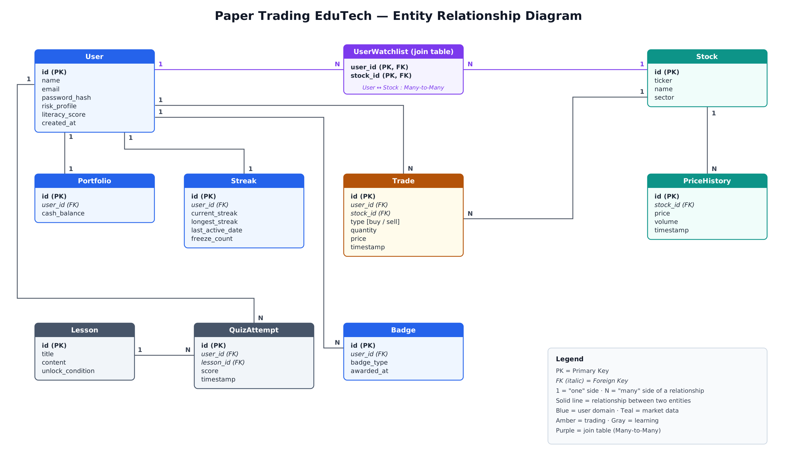

# Paper Trading Edutech

A Spring Boot REST backend for paper trading and financial learning. Users practise buying and selling stocks with virtual cash, and learn through lessons, quizzes, daily streaks and badges. No real money is involved.

> Some documents call the project *Stock Market Trainer & Wealth Growth LMS*. `stock-lms` and `com.stocklms` are the code names used for the repository and the Java packages.

## What it does

| Area | Features |
|---|---|
| Users | Registration with a unique email, an optional name and a BCrypt-hashed password, profile updates, risk profile (`CONSERVATIVE`, `MODERATE` or `AGGRESSIVE`) and literacy score. Registering a user also creates their portfolio ($100,000 starting cash) and a streak tracker. |
| Market data | Stocks and an insert-only price history. |
| Trading | BUY and SELL orders at the latest recorded price, with cash and holdings checks. Trades are stored in an insert-only ledger. |
| Learning | Lessons with unlock conditions (for example `MIN_LITERACY_20`) and quiz attempts scored 0-100. A first pass (70 or more) on a lesson raises the literacy score by 20, up to 100. |
| Engagement | Daily streaks updated by quiz and trade activity. Badges `FIRST_QUIZ`, `FIRST_TRADE` and `STREAK_3` are awarded automatically. |
| Watchlist | Users can follow stocks (many-to-many). |

## Tech stack

- Java 21, Spring Boot 4.1.1 (Spring Web MVC, Spring Data JPA, Bean Validation)
- PostgreSQL
- Swagger / OpenAPI through springdoc-openapi 2.8.9
- SLF4J and Logback for logging
- `spring-security-crypto` for BCrypt password hashing (there is no login or JWT, see [Not included yet](#not-included-yet))
- Lombok, JUnit 5, Mockito, MockMvc
- Maven (wrapper included, so Maven does not need to be installed)

## Architecture

Controller -> Repository -> Entity, with a global exception handler. Every endpoint returns the same `ResponseBean` wrapper:

```json
{
  "errorCode": "200",
  "errorDesc": "Success",
  "data": { "id": 1, "ticker": "AAPL", "name": "Apple Inc.", "sector": "Technology" }
}
```

`data` holds the entity, a list, a confirmation message, or a map of validation errors. Fields that are `null` are left out of the JSON.

## ER diagram



Nine entities (User, Portfolio, Streak, Stock, PriceHistory, Trade, Lesson, QuizAttempt, Badge) covering all four mapping types:

- One-to-One: User - Portfolio, User - Streak
- One-to-Many / Many-to-One: User - Trade, User - QuizAttempt, User - Badge, Stock - Trade, Stock - PriceHistory, Lesson - QuizAttempt
- Many-to-Many: User - Stock through the `user_watchlist` join table

## Getting started

### Prerequisites

1. JDK 21 or newer
2. PostgreSQL running on `localhost:5432` with an empty database named `stocklms`:
   ```sql
   CREATE DATABASE stocklms;
   ```
3. Environment variables:

| Variable | Default | Notes |
|---|---|---|
| `DB_USERNAME` | `postgres` | optional |
| `DB_PASSWORD` | none | **required**, the PostgreSQL password. The application does not start without it |

Tables are created automatically on first start (`spring.jpa.hibernate.ddl-auto=update`). On an empty database the app also seeds 10 US stocks with a baseline price each, 3 lessons, and a demo user (`demo@stocklms.com`, named "Demo User") with a $100,000 portfolio, a streak tracker and AAPL on the watchlist.

### Run

```bat
:: Windows (Command Prompt)
set DB_PASSWORD=your_password
mvnw.cmd spring-boot:run
```

```powershell
# Windows (PowerShell)
$env:DB_PASSWORD="your_password"
.\mvnw spring-boot:run
```

```bash
# Linux / macOS
export DB_PASSWORD=your_password
./mvnw spring-boot:run
```

The variable only lasts for the terminal window it was set in. The server starts on `http://localhost:8080`.

### Swagger UI

- Swagger UI: http://localhost:8080/swagger-ui.html
- OpenAPI JSON: http://localhost:8080/api-docs

Every endpoint is documented there, and the POST, PUT and PATCH endpoints show a request example you can edit and execute.

### Resetting to a clean database

To go back to the original seed data (10 stocks, 3 lessons, the demo user, ids starting from 1), stop the app and run this in pgAdmin or `psql`:

```sql
DROP DATABASE stocklms;
CREATE DATABASE stocklms;
```

On the next start the app recreates all tables and seeds the data again.

## REST API

All endpoints are under `/api`. Full details, status codes and sample bodies are in [`docs/api-endpoints.md`](docs/api-endpoints.md).

| Resource | Endpoints |
|---|---|
| Users | `GET /api/users`, `GET /api/users/{id}`, `POST /api/users`, `PUT /api/users/{id}`, `PATCH /api/users/{id}`, `DELETE /api/users/{id}` |
| Watchlist | `GET /api/users/{userId}/watchlist`, `POST` and `DELETE /api/users/{userId}/watchlist/{stockId}` |
| Stocks | `GET /api/stocks`, `GET /api/stocks/{id}`, `POST /api/stocks`, `PUT /api/stocks/{id}`, `DELETE /api/stocks/{id}` |
| Lessons | `GET /api/lessons`, `GET /api/lessons/{id}`, `POST /api/lessons`, `PUT /api/lessons/{id}`, `DELETE /api/lessons/{id}` |
| Portfolios | `GET /api/portfolios/{id}`, `GET /api/portfolios/user/{userId}`, `PATCH /api/portfolios/{id}` |
| Streaks | `GET /api/streaks/{id}`, `GET /api/streaks/user/{userId}`, `PATCH /api/streaks/{id}` |
| Price history | `POST /api/price-history`, `GET /api/price-history/stock/{stockId}`, `GET /api/price-history?stockId=` |
| Trades | `POST /api/trades`, `GET /api/trades/{id}`, `GET /api/trades/user/{userId}`, `GET /api/trades?userId=` |
| Quiz attempts | `POST /api/quiz-attempts`, `GET /api/quiz-attempts/user/{userId}`, `GET /api/quiz-attempts?userId=` |
| Badges | `POST /api/badges`, `GET /api/badges/user/{userId}`, `GET /api/badges?userId=`, `DELETE /api/badges/{id}` |

Price history and trades have no update or delete endpoints, because they are insert-only records. Portfolios and streaks are created with the user and removed together with the user.

Most lists can be fetched two ways, by path (`/user/{userId}`) and by query parameter (`?userId=`). Both return the same result.

## Error handling

`GlobalExceptionHandler` turns every exception into a `ResponseBean` with the matching HTTP status:

| Status | When |
|---|---|
| 400 | Validation errors (field-by-field map in `data`), business rule violations such as insufficient cash or a locked lesson, malformed JSON, wrong argument type |
| 404 | Record not found |
| 405 | HTTP method not supported |
| 409 | Duplicate entry or deleting a record that the ledger still references |
| 500 | Unexpected error, with a generic message |

## Logging

Logs go to the console and to `logs/app.log` (10 MB per file, 30 days of history). Application events are logged at INFO and the SQL statements Hibernate runs at DEBUG.

## Tests

```bat
mvnw.cmd test
```

There are 82 tests. Each controller has MockMvc tests with mocked repositories, and there is a test for the entity mappings. `StockLmsApplicationTests` starts the full application, so it needs the PostgreSQL database and `DB_PASSWORD` to be available.

## Build a JAR or a WAR

```bat
mvnw.cmd clean package -DskipTests            :: executable JAR: target\stocklms.jar (default)
mvnw.cmd clean package -DskipTests -Pwar      :: WAR: target\stocklms.war
```

Leave out `-DskipTests` to run the tests while packaging (needs the database).

- Run the JAR (with `DB_PASSWORD` set): `java -jar target\stocklms.jar`
- Deploy the WAR: copy `target/stocklms.war` into the `webapps` folder of a Servlet 6.1 compatible container such as Tomcat 11, with `DB_PASSWORD` set in its environment. The application is then served under `/stocklms`, for example `http://localhost:8080/stocklms/swagger-ui.html`.

## Project structure

```
src/main/java/com/stocklms/stock_lms
  controller/     REST endpoints, one controller per resource
  repository/     Spring Data JPA repositories
  entity/         JPA entities and their relationships
  responsebean/   ResponseBean, the standard response wrapper
  exception/      custom exceptions and GlobalExceptionHandler
  config/         OpenAPI config, BCrypt bean, data seeder, database connection check
src/main/resources/application.properties
src/test/java/    controller tests, entity mapping test, application context test
docs/             ER diagram, requirements, API endpoints, product requirements document
```

## Not included yet

This submission is the backend core. The product requirements document (`docs/stock-lms-prd.docx`) describes the full multi-semester vision, and these parts of it, listed in [`docs/requirements.md`](docs/requirements.md) (Section 6), are planned for later:

- Login and JWT security. Passwords are hashed with BCrypt, but no endpoint is protected.
- Automatic market-data ingestion from a live API, and real-time prices. Prices are added through `POST /api/price-history`.
- Automatic risk-profile calculation, leaderboards, and applying streak freezes. The risk profile is set through the API and the freeze count is stored but not yet used.
- A frontend.